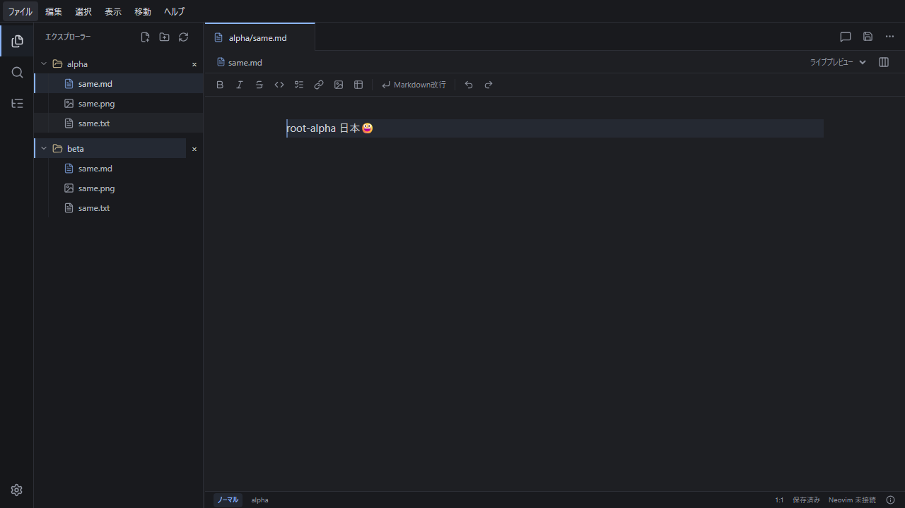
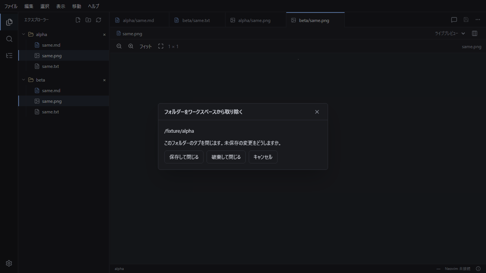

# Marxen

Vim の操作とライブプレビューを組み合わせた、Rust / Tauri 製の Markdown デスクトップエディターです。実 Neovim のバッファを文書の正本にし、編集・保存・AI 通信を Rust が管理します。

## デスクトップでの操作

1. 「フォルダーを開く」で作業フォルダーを選びます。エクスプローラーにはフォルダー、Markdown、テキスト、対応画像を表示し、種類ごとのアイコンを付けます。タブ、クイックオープン、検索・置換、アウトライン、コマンドパレットも使用できます。
2. Markdown は「ライブ」「Markdown」「閲覧」「分割」で切り替えます。ライブでは編集中のブロックに記法とカーソルを表示し、それ以外を描画します。分割は Markdown 編集とプレビューを左右に並べ、幅をドラッグで調整できます。表示切替では本文・カーソル・Undo を保持します。
3. 実 Neovim が `i` / `Esc`、移動、text object、macro、`u` / `Ctrl+r` を処理します。画面の折り返しに沿う移動も選べます。画面依存の plugin 操作にはメニューの「Neovim 画面」を使用します。
4. 「保存」または Vim の `:w` で Rust の保存経路を使います。外部変更や保存競合は通知されます。「再読込（未保存を破棄）」は編集中の内容を破棄する操作です。未保存のタブを閉じると選択肢が表示され、次回起動時にはクラッシュ復元の候補を表示します。
5. 設定は外観・エディター・Vim・コピー・AI に分かれています。テーマ、文字サイズ、行間、折り返し、行番号、編集中の行の強調を調整し、次回起動時も保持します。Neovim は専用設定を既定とし、`.vimrc` / `vimrc` / `_vimrc` / `init.vim` / `init.lua` も読み込めます。「設定を適用して再起動する」は本文・revision・未保存状態を保持し、Undo とモードを初期化します。設定のエラーは画面に表示します。

テキストファイルは記法を描画せずに編集します。画像は専用タブで閲覧し、フィット表示・実サイズ・拡大縮小を切り替えられます。エクスプローラーの画像を Markdown 本文へドラッグすると相対リンクを挿入し、外部の画像ファイルはワークスペースへコピーして挿入します。

## 複数フォルダーで使う

1. 「ファイル」メニューの「フォルダーを開く」で最初のフォルダーを開き、「ワークスペースにフォルダーを追加」で2つ目以降を足します。フォルダーを足しても、開いている文書・未保存の変更・タブ・選択位置はそのまま残ります。
2. エクスプローラーはフォルダーごとに見出しで分けます。別フォルダーに同名の文書や画像があっても、タブにはフォルダー名を付けて（`alpha/same.md` と `beta/same.md`）別々に開きます。画像もフォルダーごとに別タブで見分けます。
3. 見出し横の `×` でフォルダーを外すと確認が表示され、「保存して閉じる」「破棄して閉じる」「キャンセル」から選びます。「保存して閉じる」はそのフォルダーの未保存を保存してから閉じ、「破棄して閉じる」は未保存を捨て、「キャンセル」や保存失敗ではフォルダーとタブを残します。
4. 開いたフォルダー一覧・タブ・選択中のタブ・カーソル位置は保存され、次回起動や再読み込みで戻ります。見つからないフォルダーや開けないタブがあっても自動で消さずに残します。
5. 「ファイル」メニューやツリーの右クリックでは、新規 Markdown・新規フォルダー・名前の変更・再読込・閉じる・更新を使えます。ツリーで対象を選んで `F2` を押すと名前の変更ができます。名前の変更は文書・画像・フォルダーが対象で、フォルダーの見出し自体の名前は変えられません。詳しい検証範囲は[ワークスペース保存・復旧の検証](docs/workspace-verification.md)を参照してください。

操作例を画像で示します。



*2つのフォルダー（alpha / beta）と、同名の文書・画像・テキストを分けて表示した例。タブはフォルダー名付きで区別します。*



*フォルダーを取り除くときの確認。「保存して閉じる」「破棄して閉じる」「キャンセル」を選べます。*

`yy` / `yw` / `yiw` / 選択して `y` の直後に、次の形式キーを押すと OS のクリップボードへコピーします。別のキーを押すと通常の Vim 操作になります。既存のユーザーマッピングがあるキーはそのマッピングを優先します。

| キー | コピー形式 |
| --- | --- |
| F6 | Markdown |
| F7 | 装飾なしテキスト |
| F8 | リッチテキスト（HTML と通常テキスト、Windows / macOS は画像入り RTF も提供） |
| F9 | HTML ソース |

リッチテキストの相対画像は埋め込みデータにして渡します。PNG / JPEG は画像を保持し、RTF 用の GIF / WebP は静止画になります。外部 URL の画像は HTML の参照を保持します。貼り付け先が使う形式はアプリにより異なります。

vimrc の例（1 キーの Neovim 表記を指定、空文字で無効化）:

```vim
let g:marxen_copy_markdown_key = '<F6>'
let g:marxen_copy_text_key = '<F7>'
let g:marxen_copy_rich_key = '<F8>'
let g:marxen_copy_html_key = '<F9>'
```

GFM の表・task list・Alerts・脚注、highlight、数式、Mermaid、sanitized HTML、GeoJSON / TopoJSON、ASCII STL を描画します。描画ライブラリは同梱します。相対画像と画像貼付はワークスペースの資源として扱います。

## AI 接続と変更の承認

Agent チャットの接続設定で、Codex ACP (`codex-acp`)、OpenCode ACP (`opencode acp`)、GitHub Copilot ACP (`copilot --acp --stdio`)、任意コマンド、OpenAI 互換 Chat Completions、Anthropic Messages を登録します。ACP adapter は利用者が導入します。Anthropic は利用者の明示設定で有効にします。API 資格情報は OS ストアに保存します。

Agent・インライン両チャットの入力欄で接続先とモデルを選びます。「モデルを選ぶ」は ACP エージェントに接続して公開されたモデル・推論強度の候補を取得します。送信前に選択値を設定し、エージェントの応答が一致することを確認します。候補を公開しないエージェントは CLI の設定を使います。直接 API のモデル名は入力欄で指定できます。接続設定はテーマを継承するダイアログで開き、Escape で閉じて元の操作へ戻れます。Windows の ACP プロセスは別のコンソール窓を表示せず、回答をチャットへ表示します。

Agent チャットでは質問・生成・選択書き換え・ワークスペース編集を選び、会話を続けられます。選択があればその範囲、選択がなければ現在のファイルを参照します。会話一覧から以前の会話へ戻れ、パネルを閉じても履歴を保持します。履歴はアプリを終了すると消えます。接続先やモデルの変更では会話を分離し、以前の履歴を別の接続先へ送りません。

`Ctrl+Shift+I`（macOS は `Cmd+Shift+I`）で、選択範囲または現在の段落を対象にインラインチャットを開きます。編集位置の近くで指示と提案を確認でき、`Escape` で閉じて本文へ戻ります。Vim の `Ctrl+I` はそのまま使えます。

AI の回答は Markdown として表示します。編集の提案は隔離コピーの差分を確認し、承認して文書へ反映します。承認後もファイル保存は別操作です。取消は処理の終了が確認されてから確定します。revision やディスクの競合がある場合は対象範囲を指定し直します。隔離コピーは同一マシンの作業領域であり、OS sandbox ではありません。

実 API への要求や CLI の prompt 送信には利用者の接続設定・認証が必要です。通常の回帰テストはローカル mock を使います。Claude Code の preset は提供しません。

## 開発環境と検証

CI / Linux x64 devcontainer は Node 22.23.2 と Rust 1.99.0 を使用します。Windows の MSVC / WebView2、macOS の Xcode Command Line Tools、Linux の WebKitGTK 4.1 など、[Tauri の前提環境](https://v2.tauri.app/start/prerequisites/)を用意してください。Windows の Rust コマンドは x64 Developer PowerShell から実行できます。

```sh
npm ci
npm run bundle:neovim
npm run verify:neovim
npm run desktop:dev     # 実 Neovim を使うデスクトップアプリ
npm run dev             # 読み取り専用のブラウザ表示
npm run typecheck
npm run architecture:check
npm test
npm run test:bundling
npm run contracts:check
npm run ai-contracts:check
npm run isolation-contracts:check
cargo fmt --manifest-path src-tauri/Cargo.toml -- --check
cargo test --manifest-path src-tauri/Cargo.toml --locked --features dev-tools
cargo check --manifest-path src-tauri/Cargo.toml --locked
cargo clippy --manifest-path src-tauri/Cargo.toml --locked --features dev-tools --all-targets -- -D warnings
npx playwright install chromium
npm run test:e2e
npm run build
```

`dev-tools` は契約生成器とテスト用プロセスだけを有効にします。通常の配布ビルドでは有効にせず、これらの実行ファイルは同梱しません。

Rust 型の変更後は対応する `contracts:generate` / `ai-contracts:generate` / `isolation-contracts:generate` を実行します。GUI 依存のない環境では `cargo test --manifest-path src-tauri/Cargo.toml --no-default-features --locked --features dev-tools` を使用できます。実 Neovim はこの場合も必要です。Rust の lint は clippy、TypeScript は typecheck を実行します。独立した TypeScript lint の設定はありません。

Playwright は製品用 production build と、配布に含まれないライブ描画 harness の2系統を実行します。既存サーバーは再利用しません。競合する場合は `MARXEN_E2E_PORT` / `MARXEN_E2E_LIVE_PORT` を変更できます。Chromium の成功は OS 固有の WebView・IME の成功を意味しません。

実 OS 資格情報ストアの検証は opt-in です。使い捨ての専用 entry を保存・再取得・削除し、利用者の API 資格情報は使いません。

```powershell
$env:MARXEN_NATIVE_KEYRING_TEST = '1'
cargo test --manifest-path src-tauri/Cargo.toml --locked --features dev-tools --test credentials_native
Remove-Item Env:MARXEN_NATIVE_KEYRING_TEST
```

## 配布

```sh
npm run desktop:build
# Windows の NSIS に限定する場合
npm run desktop:build -- --bundles nsis
```

公式 Neovim 0.11.5 archive を固定 SHA-256 で検証し、実行ファイル・DLL・runtime 全体を取り込みます。別 target の取得は `npm run bundle:neovim -- --target <Rust target>`、runtime smoke は対応 OS / CPU で実行します。package は `src-tauri/target/release/bundle/` に生成します。CI の明示 target build は `src-tauri/target/<Rust target>/release/bundle/` に生成します。

展開した package の Neovim 資源は `MARXEN_VERIFY_NVIM_ROOT` にその `neovim` ディレクトリを指定して `npm run verify:neovim` で検証できます。この検証先指定は同梱確認スクリプトだけに適用されます。

CI は Windows x64 (NSIS)、macOS arm64 / x64 (app / DMG)、Linux x64 (deb / AppImage) の native build、3種類の IPC 契約、Rust / TypeScript / unit / E2E を設定します。配布版は未署名です。署名・公証は対応する資格情報のある環境で別途実施します。

公開は版タグが起動する別の Release workflow が行います。版変更・main CI・`vX.Y.Z` タグ・CD の順にし、CD で再ビルドしません。

```sh
git push origin v0.1.0
# 復旧で既存タグを使う場合のみ Actions の workflow_dispatch に tag を指定する
```

タグ commit と同一 SHA の main push Integration 成功だけを使い、四つの `marxen-{target}` から最終 installer 5（Windows x64 NSIS、Linux x64 deb と AppImage、macOS arm64 と x64 DMG）と `SHA256SUMS` を公開します。草稿で検査してから公開し、公開済みは上書きしません。配布は未署名・未公証で、実 WebView・日本語 IME・導入は未検証です。macOS 実機の確認はありません。`SHA256SUMS` で検証してください。

実施済みの回帰・Windows 配布確認と、未実施の OS・WebView・日本語 IME・署名の範囲は [Issue #9](https://github.com/staka-devs/marxen/issues/9) で報告します。他 OS の package 操作、実 WebView / IME、署名・公証をブラウザや Windows の成功から推定しません。devcontainer の GUI にはホストの表示サーバーが必要です。

[実装契約](docs/implementation.md)、[文書 IPC](docs/foundation.md)、[AI 接続の検証](https://github.com/staka-devs/marxen/issues/7)、[隔離・承認](docs/isolation.md)、[AnyDR](docs/adr/README.md) を参照してください。

製品コードは Rust / TypeScript とも `domain / application / contracts / infrastructure / presentation` に分けます。内側はユースケースと利用する port を所有し、composition root が具体的な adapter を注入します。[依存方向とメソッド文書の規約](docs/adr/ADR-0103-五層の依存方向とメソッドの文書を検査する.md) に従い、公開・非公開の名前付き関数・メソッド・trait 操作へ Rustdoc / JSDoc を付けます。`npm run architecture:check` は配置・依存・文書の欠落を検査し、`npm run test:bundling` は検査スクリプトの回帰も実行します。
