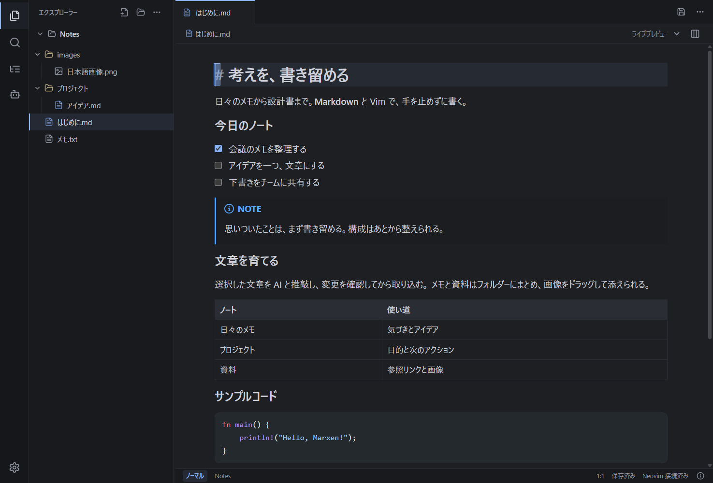

# 編集画面・検索・チャットの UI 検証

検証日: 2026-10-10。実装ソース: `25a7fee430d16ea4e437c81cfdcafcd5890d8689`。Windows x64 / Tauri / WebView2 / 同梱 Neovim。[Issue #20](https://github.com/staka-devs/marxen/issues/20)。

## 画面と操作

タブとファイル操作、ファイルの場所と表示モードを二行に整理した。細いアクティビティバー、種別アイコンと階層線、折り畳めるルートフォルダー、本文の幅・見出し・行間、青いカーソルと編集中の行の強調を使う。非選択のブロック間だけを詰め、文書と UTF-16 の位置を変えない。

検索は矢印・Enter・Esc・フォーカス復帰を共通化した。デスクトップには実際の対応ファイルだけを表示する。ファイル検索・ツリー・タブの選択後は編集欄にフォーカスを戻し、モーダルからは奪わない。設定はカテゴリ別に表示し、検索は全カテゴリを対象にする。チャットの発言・入力・接続設定、インラインの対象と提案を整理した。入力例は自動送信しない。

[ライト](issue-20-ui/editor-light.png) · [分割](issue-20-ui/split.png) · [設定](issue-20-ui/settings-editor.png) · [AI 設定](issue-20-ui/settings-ai.png) · [Agent](issue-20-ui/agent-chat.png) · [インライン](issue-20-ui/inline-chat.png) · [提案](issue-20-ui/inline-review.png) · [狭い編集画面](issue-20-ui/editor-narrow.png) · [狭い検索画面](issue-20-ui/quick-open-narrow.png) · [狭い設定画面](issue-20-ui/settings-narrow.png)

## 実アプリの確認

NSIS を展開し、そのアプリと同梱 Neovim を使う実 WebView の画面を目視で確認した。1180 × 800、実ウィンドウを縮めた 719 × 595（CSS px、Windows 125%）で確認。狭い画面ではファイル選択でサイドバーが閉じ、検索と設定は画面内に収まる。文書全体の横方向のはみ出しはない。

| 操作 | 結果 |
| --- | --- |
| ダーク・ライト、見出し、リスト、Alert、表、コード | 文字組みを確認。日本語は実際に Yu Gothic UI を使用 |
| 分割 | 独立した二領域、各 442.5px、幅を変更できる区切り |
| 検索・設定 | 実ファイルのみ、矢印選択、Esc、編集フォーカスの復帰、中心配置、狭い画面に収まる |
| Agent | ローカル ACP fixture で質問・回答、会話の作成・切り替え。本文不変 |
| インライン | 見出しを対象に入力フォーカス、エディター内に収まる位置 |
| 提案・承認・Undo | 提案時は本文不変。見出しだけを承認、一回の UI Undo で元の本文・保存済みに復帰 |

操作は実 WebView の DOM / キーイベントによる。OS の物理キーや日本語 IME の確認と区別する。AI はローカル fixture で、外部アカウントへ接続していない。検証用文書に未保存変更を残さない。

## 手動チェックと設計

| コマンド | 結果 |
| --- | --- |
| `npm ci` | 成功、脆弱性 0。同一 lockfile の `bcec6af` で確認 |
| `npm run typecheck` | 成功 |
| `npm run architecture:check` | 209 ファイル、1646/1646 操作に文書、違反 0 |
| `npm test -- --pool=threads --maxWorkers=1` | 43 ファイル / 255 件成功 |
| `npm run test:bundling` | Node 19 件成功 |
| `npm run build` | 成功 |
| `npm run test:e2e:product -- --workers=1` | 12 件成功 |
| `npm run test:e2e:live -- --workers=1` | 17 件成功 |
| `npm run tauri -- build --config src-tauri/tauri.bundle.conf.json --bundles nsis` | 成功 |

表示責務は presentation、検索と接続先の表示は小さい共通実装にする。編集・保存・AI の port と revision 契約、五層の依存境界を維持する。表示用の独立した保存・AI 通信は追加しない。設定値は実際のエディターへ反映する。静的検査と、SOLID・YAGNI・DRY の全面的な証明を区別する。

Rust は `4e9ffcf` から変更なし。165 件、fmt、check、Clippy、private Rustdoc、三種の生成契約の前回成功と、フロントエンドの今回の再実行を区別する。[手動 CI](manual-ci.md) に範囲を記載する。

## Windows 配布物

`.local/releases/windows/Marxen_0.1.0_x64-setup.exe`、未署名 NSIS。インストールせず展開して確認。

| 項目 | 値 |
| --- | --- |
| サイズ | 15811150 bytes |
| インストーラー SHA-256 | `b3ce6e956a3fbca6b999087eb42bcd43007ae30847eb74322c3d22e69553958d` |
| 展開アプリ SHA-256 | `88856708703c5855d7d407b26ffaaacc125c5a4b0c1b59721af200c7f46938c3` |
| 同梱 Neovim | 2067 ファイル、全ファイル集合・SHA-256 が配布元と一致 |
| 開発用バイナリー | 契約出力・ACP / 隔離 mock を含まない |

アプリは build 出力と NSIS 識別子の三 bytes を除いて一致する。実プロセスの親子関係から展開先の Neovim を使うことを確認した。

Windows の実 IME、OS キー注入、外部 AI の実認証・生成、メールへの画像入り貼付、macOS / Linux の実 WebView / IME、NSIS の実インストール・アンインストールと署名は含めない。Word の画像入り貼付と Rust の検証対象は [統合検証](issue-9-integration.md) を参照する。
