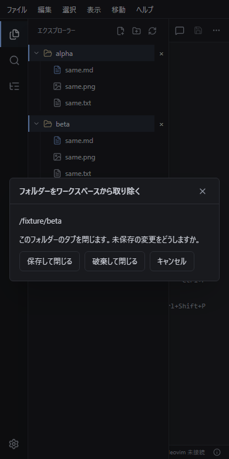

# ワークスペース保存・復旧の検証

対象は main `ff10a908` で、PR95 の `a17cabe` と tree `dcd591100581964a34570b68eb58d52bee80869c` が同一である。複数のフォルダー・同名文書と画像の分離・追加と削除の保存/破棄/取消・配置復元・ファイルメニューとツリー操作を範囲とする。

方法を区別する。native CLI / Neovim は実バイナリと実ファイルでの実行、browser fixture は Chromium 上の production shell と模擬 transport による表示・操作の確認、actual WebView / 物理 IME は各 OS の実表示・実入力での確認である。Chromium の成功を実 WebView・IME の成功としない。本文の画像は browser fixture であり、実 OS のスクリーンショットではない。

## 検証結果

| 検証 | 結果 |
| --- | --- |
| 4 OS CI の full suites と native packages（Windows x64 NSIS、macOS arm64 / x64、Linux x64 deb / AppImage、契約・Rust / TypeScript / unit / E2E を含む） | 成功（[CI 38819531129](https://github.com/staka-devs/marxen/actions/runs/38819531129)） |
| focused 確認: `typecheck`、architecture 340 files / 2866 operations、localization 811 keys、contracts 4 種、bundling 19、build、fmt、check、clippy、doc、`verify:neovim`（同梱 Neovim 0.11.5） | 成功 |
| focused Vitest 16 files / 149 tests + 修正後焦点 20 tests | 成功 |
| native `multi_root` 6 tests / `workspace` 29 tests / `isolation` 32 tests（Windows 実一時フォルダー + 同梱実 Neovim、Unix symlink 除外） | 成功 |
| browser `multi-root` 2 tests + `workbench` 1 test（390px、en-US / ja-JP / 関西・徳島、削除確認の境界表明） | 成功（実 WebView・IME の証拠にしない） |
| Linux container / 手動 CLI: `npm ci`、Neovim bundle + verify、architecture / localization / typecheck、contracts 4 種、bundling、Vitest 88 files / 696 tests、frontend build、fmt | 成功 |
| Linux container / 手動 CLI: Rust tests / check / clippy / doc、Playwright、deb / AppImage の手動確認 | 未検証 |
| Linux 実デスクトップの WebView / IME / install | 未検証 |
| macOS 実機の WebView / IME / install（実機なし） | 未検証（CI build 成功を実機成功としない） |
| 署名・公証 | 未検証 |

*狭幅での削除確認の表示例。browser fixture であり、実 OS のスクリーンショットではない。*

## 制限

- main `ff10a908` では混在改行入力の白画面（Issue #92）は直っていない。
- PR94 ソース `154c5c6` の実 WebView2 確認は別ソースの証拠であり、main `ff10a908` の証拠としない。
