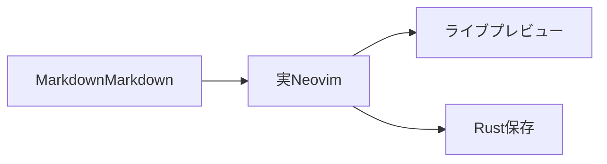

# GitHub Markdown 互換サンプル

日本語・絵文字 😀・**太字**・*斜体*・~~取り消し線~~・`inline code`。

## リスト・表・リンク

- 通常の項目
  - 入れ子の項目
- [ ] 未完了のタスク
- [x] 完了したタスク

1. 番号付き項目
2. 次の項目

| 項目 | 左寄せ | 中央 | 右寄せ |
| --- | :--- | :---: | ---: |
| 日本語 | **装飾** | `code` | 123 |
| Emoji | 😀 | ✓ | 456 |

[見出しへのリンク](#コードと図)・[相対文書](../../README.md)・https://github.com/staka-devs/marxen


本文から脚注を参照する。[^note]

[^note]: 脚注にも日本語と *装飾* が使える。

## Alerts

> [!NOTE]
> 補足情報。

> [!TIP]
> 操作のヒント。

> [!IMPORTANT]
> 重要な情報。

> [!WARNING]
> 注意が必要な情報。

> [!CAUTION]
> 慎重に扱う情報。

## コードと図

```rust
fn main() {
    println!("こんにちは、Marxen 😀");
}
```

```markdown
> [!NOTE]
> コードブロック内の記法は描画しない。
```



## 数式

インライン数式 $E = mc^2$ と $\alpha + \beta = \gamma$。

$$
\int_0^1 x^2\,dx = \frac{1}{3}
$$

```math
\begin{pmatrix}1 & 2 \\ 3 & 4\end{pmatrix}
```

## HTML

<details>
<summary>詳細を開く</summary>

折りたたみの中にも **Markdown** を表示する。

</details>

<kbd>Ctrl</kbd> + <kbd>S</kbd>、<sub>下付き</sub>、<sup>上付き</sup>、<br>改行。

<!-- HTMLコメントは見た目に表示しない。 -->

## 地図

```geojson
{"type":"FeatureCollection","features":[{"type":"Feature","properties":{"name":"東京"},"geometry":{"type":"Point","coordinates":[139.7671,35.6812]}}]}
```

```topojson
{"type":"Topology","objects":{"region":{"type":"Polygon","arcs":[[0]],"properties":{"name":"サンプル領域"}}},"arcs":[[[139,35],[140,35],[140,36],[139,36],[139,35]]]}
```

## ASCII STL

```stl
solid tetrahedron
  facet normal 0 0 -1
    outer loop
      vertex 0 0 0
      vertex 0 1 0
      vertex 1 0 0
    endloop
  endfacet
  facet normal 0 -1 0
    outer loop
      vertex 0 0 0
      vertex 1 0 0
      vertex 0 0 1
    endloop
  endfacet
  facet normal -1 0 0
    outer loop
      vertex 0 0 0
      vertex 0 0 1
      vertex 0 1 0
    endloop
  endfacet
  facet normal 0.57735 0.57735 0.57735
    outer loop
      vertex 1 0 0
      vertex 0 1 0
      vertex 0 0 1
    endloop
  endfacet
endsolid tetrahedron
```

## Markdown保持

* 箇条書きの記号と    空白は未編集なら保持する。

リンクの定義方式も保持する。[GitHub][github]

[github]: https://github.com "GitHub"
